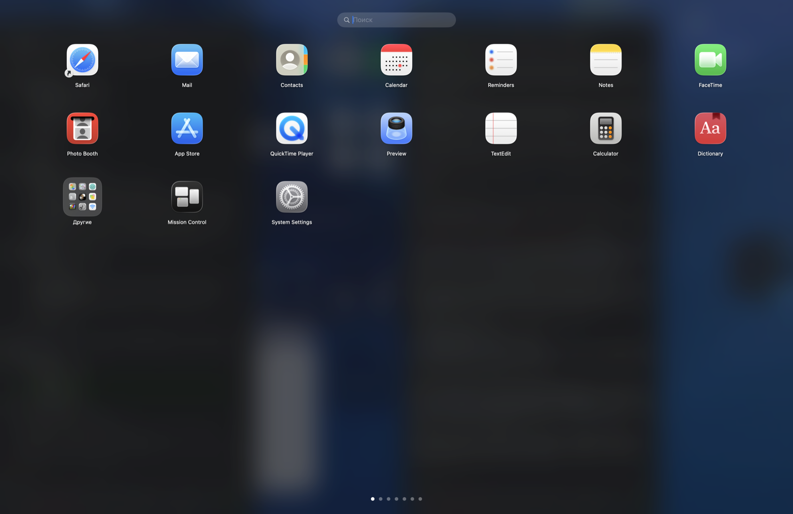

# Launchpad

Открытый бесплатный аналог классического **Launchpad** для macOS, который Apple
убрала в macOS 26 (Tahoe). Возвращает привычную полноэкранную сетку приложений
со страницами и папками. Аналог [LaunchNext](https://github.com/RoversX/LaunchNext)
и AppGrid, но полностью бесплатный и с открытым кодом (MIT).



## Возможности

- 🚀 **Полноэкранная сетка** приложений со страницами и точками-индикаторами
- 📁 **Папки** — перетащите одно приложение на другое, чтобы создать папку;
  название подбирается по категории приложений («Игры», «Утилиты»…) и меняется;
  приложение можно удалить прямо из открытой папки
- ↔️ **Перенос между страницами** — тащите иконку к краю экрана, страницы
  листаются; у правого края создаётся новая страница
- ⚙️ **Настройки** (`⌘,`) — размер сетки (колонки/строки) и выбор горячей клавиши
- 📥 **Импорт старой раскладки** — читает базу данных системного Launchpad
  (`~/Library/Application Support/Dock/*.db`) и восстанавливает ваши страницы,
  порядок и папки по bundleID
- 🔍 **Поиск** по названию, словам и сокращениям с поддержкой неверной русской/английской раскладки; стрелки выбирают результат, Enter запускает выбранное приложение
- ↩️ **Отмена и повтор** изменений раскладки (`⌘Z` / `⇧⌘Z`), резервные копии перед импортом и сбросом
- 🪶 **Фоновое обновление списка** — сохранённая сетка показывается сразу, новые приложения подхватываются без ожидания сканирования
- ⚡ **Быстрый повторный запуск** — растеризованные иконки сохраняются в локальном кэше и инвалидируются при обновлении приложения
- 💾 **Переносимая раскладка** — экспорт и импорт JSON-файла с автоматической резервной копией
- 🙈 **Скрытые приложения** — обратимое скрытие через контекстное меню и восстановление в настройках
- 📂 **Свои каталоги** — подключение дополнительных папок с `.app` и наблюдение за ними через FSEvents
- 🤏 **Жест щипка** — сведение нескольких пальцев открывает Launchpad
  (чтение трекпада через MultitouchSupport), щипок внутри — закрывает;
  отключается в настройках, после сна трекпад переподключается сам
- ⌨️ **Горячая клавиша** `F4` (или `⌥⌘Space`, или своё сочетание, записанное
  в настройках) открывает/закрывает
- 🖱️ **Листание** страниц: свайп двумя пальцами, Page Up/Page Down, точки внизу
- ♿️ **Доступность** — навигация по сетке и папкам стрелками/Tab, заметный
  клавиатурный фокус, подсказки VoiceOver и поддержка повышенного контраста
- ❓ **Встроенная памятка** по управлению открывается клавишей `?` или `⌘?`
- 🧭 **Восстановление позиции** — Launchpad запоминает страницу, выбранную
  иконку и открытую папку между показами и перезапусками
- 🎨 Живое **размытие** рабочего стола на фоне
- 🪶 Живёт в строке меню, **без иконки в Dock** (агент-приложение)

## Требования

- macOS 13 (Ventura) и новее, Apple Silicon или Intel (релиз — универсальный бинарник)
- Swift 5.9+ (входит в Xcode или Command Line Tools — полный Xcode **не нужен**)

## Установка

**Готовый DMG** (проще всего): скачайте `Launchpad-x.y.z.dmg` из
[Releases](https://github.com/ev609/Launchpad/releases), откройте и перетащите
Launchpad в Applications. Ad-hoc подпись — при первом запуске снимите карантин:
`xattr -dr com.apple.quarantine /Applications/Launchpad.app`.

**Из исходников:**

```bash
git clone <repo> Launchpad && cd Launchpad
./scripts/build_app.sh release   # или ./scripts/install.sh — сразу в /Applications
open build/Launchpad.app
```

Дальше приложение **обновляется само** через GitHub Releases: фоновая проверка
при запуске и каждые 6 часов, при найденном обновлении оно тихо скачивается и
устанавливается (агент перезапускается незаметно). Каждый ZIP подписан Ed25519;
подпись проверяется до распаковки, а замена приложения выполняется через staging
с восстановлением прежней версии при ошибке. Автоустановку можно отключить
галочкой «Обновлять автоматически» — тогда останется ручной пункт
«Проверить обновления…».

### Скрипты сборки

- `scripts/build_app.sh` — собрать `.app`
- `scripts/install.sh` — собрать и установить в `/Applications`
- `scripts/make_dmg.sh` — собрать DMG для ручной раздачи
- `scripts/release.sh 0.2.0` — выпустить релиз (zip + dmg) в GitHub Releases

Релизный скрипт подписывает `Launchpad.zip` ключом
`~/Library/Application Support/Launchpad/update-signing-key.pem`. Приватный ключ
не хранится в репозитории: его нужно отдельно и надёжно резервировать. Путь можно
переопределить переменной `LAUNCHPAD_UPDATE_PRIVATE_KEY`.

Релиз выпускается только для коммита, который уже отправлен на GitHub и прошёл
CI (`gh run list`): обновление ставится пользователям без подтверждения.
Аварийный обход — `LAUNCHPAD_SKIP_CI_CHECK=1`.

С сертификатом Developer ID приложение подписывается с hardened runtime и
нотаризуется — тогда снимать карантин вручную не нужно:

```bash
xcrun notarytool store-credentials launchpad-notary --apple-id … --team-id …
LAUNCHPAD_SIGN_IDENTITY="Developer ID Application: …" \
LAUNCHPAD_NOTARY_PROFILE=launchpad-notary ./scripts/release.sh 0.3.0
```

Приложение появится в строке меню (иконка сетки 3×3). Нажмите на неё или `F4`,
чтобы открыть Launchpad.

> Если `F4` не срабатывает — включите в
> «Системные настройки → Клавиатура» опцию использовать F1–F12 как стандартные
> функциональные клавиши, либо пользуйтесь `⌥⌘Space` или иконкой в строке меню.

### Открытие щипком (важно для macOS Tahoe)

Чтобы щипок пальцами открывал **этот** Launchpad, а не системный Spotlight:

1. **Системные настройки → Трекпад → Ещё жесты** — отключите системный жест
   щипка (бывший «Launchpad», на Tahoe открывает Spotlight). Иначе откроются оба.
2. При первом использовании macOS может запросить разрешение
   **«Мониторинг ввода»** (Input Monitoring) — разрешите приложению в
   «Настройки → Конфиденциальность и безопасность → Мониторинг ввода».

После этого сведение нескольких пальцев на трекпаде открывает Launchpad.

### Автозапуск при входе

**При первом запуске на любом компьютере** Launchpad показывает короткую настройку:
в ней можно явно выбрать автозапуск при входе (`SMAppService`), авто-перезапуск
(`launchd` keep-alive), автоматические обновления и импорт старой раскладки.
Все параметры позднее можно изменить в меню и настройках.

Механизмы взаимоисключающие: при включённом авто-перезапуске login item снимается
(LaunchAgent сам стартует при входе), иначе при входе запускались бы две копии.
При включении авто-перезапуска экземпляр, запущенный `launchd`, один раз
перезапускает приложение и забирает управление у открытого вручную. Автозапуск
и автообновление недоступны, если приложение запущено из образа диска, из
карантинной копии (App Translocation) или с тома только для чтения — сначала
перенесите его в `/Applications`. После переноса приложения путь в LaunchAgent
обновляется при следующем запуске.

**Про хоткей и «закрытое» состояние.** Глобальную клавишу слушает сам процесс,
поэтому она работает, пока ланч запущен (а он резидентен → почти всегда). Если вы
осознанно нажали **«Выход»**, ланч завершается — и до следующего входа в систему
клавиша его не поднимет: macOS из соображений безопасности **не даёт приложению
назначить системный хоткей, переживающий его смерть**. Если нужна клавиша,
запускающая ланч даже после «Выхода», создайте команду в приложении **«Команды»**
(действие «Запустить shell-скрипт»: `open -a Launchpad --args --open`) и назначьте
ей сочетание — это единственный поддерживаемый macOS способ запуска закрытого
приложения по клавише.

## Меню в строке меню

- **Открыть Launchpad**
- **Импортировать раскладку старого Launchpad** — восстановить страницы и папки
- **Сбросить раскладку (по алфавиту)**
- **Обновить список приложений** — пересканировать после установки новых программ
- **Запускать при входе** — автозапуск (галочка)
- **Держать запущенным** — авто-перезапуск через launchd (галочка)
- **Проверить обновления…** — проверить вручную; ставит новую версию из GitHub Releases
- **Обновлять автоматически** — фоновая проверка каждые 6 ч и тихая установка (выбор предлагается при первом запуске)
- **Настройки…**
- **Выход**

## Поиск и восстановление раскладки

В поиске точное название имеет приоритет над началом слова и сокращениями:
`gc` найдёт Google Chrome, `vsc` — Visual Studio Code, `ыафкш` — Safari.
Стрелки ←/→ выбирают соседнюю иконку, ↑/↓ переходят между рядами,
Tab / Shift-Tab выбирают следующий / предыдущий результат. Enter запускает
выбранное приложение. Сочетания с Option и Command остаются доступны для
редактирования текста; ввод с IME не перехватывается.

Перемещение, создание и переименование папок, извлечение приложений, импорт
и сброс можно отменить через меню «Правка» или `⌘Z`, повторить — `⇧⌘Z`.
При редактировании текста эти сочетания отменяют ввод. История раскладки
хранится до завершения приложения, изменения состава приложений или размера
сетки. Перемещение приложения в Корзину в эту историю не входит.

Перед импортом, сбросом и восстановлением создаётся отдельная копия в
`~/Library/Application Support/Launchpad/Backups/`. Если копию сохранить не
удалось, операция не выполняется. В настройках есть команда восстановления
последней резервной копии; сами копии сохраняются и после перезапуска.

Частые изменения раскладки объединяются и записываются в фоне; перед чтением и
завершением приложения последнее состояние принудительно сохраняется. Запись
проходит через проверяемый журнал: после аварийного завершения последняя
подтверждённая версия автоматически восстанавливается.

Каталоги сканируются в фоне при запуске, открытии сетки, по ручной команде и
после реальных файловых изменений, полученных через FSEvents. Периодического
обхода каждые 30 секунд нет. Обход включает поддерживаемые подпапки; при
недоступности каталога его приложения сохраняются. Во время перетаскивания
применение результатов откладывается до завершения жеста.

Если в macOS включены «Уменьшение прозрачности» или «Уменьшение движения»,
Launchpad заменяет размытие однотонным фоном и отключает лишние пружинные
анимации — это также снижает нагрузку на GPU на слабых компьютерах.
Режим «Увеличение контраста» усиливает контуры, фон элементов и индикаторы
страниц. Без поиска стрелки и Tab перемещают фокус по приложениям, Shift-Tab —
назад, Home/End — в начало/конец страницы, Page Up/Page Down листают страницы,
а Return или пробел открывают выбранное приложение или папку. Escape сначала
снимает клавиатурный фокус, затем закрывает Launchpad.
Option со стрелками переставляет выбранный элемент, в том числе между страницами;
в открытой папке сочетание меняет порядок приложений. `⌥⌘←` / `⌥⌘→` объединяют
выбранный элемент с соседом, а `⌥⌘↑` извлекает выбранное приложение из папки.
Те же операции, а также скрытие приложения и показ в Finder, доступны как
пользовательские действия VoiceOver.
Памятка со всеми сочетаниями открывается клавишей `?`, через меню «Справка» или
из меню в строке меню. Последняя страница, выбранная иконка и открытая папка
сохраняются при закрытии Launchpad; если приложение или папка исчезли, состояние
безопасно сбрасывается к существующей странице.

Открытие окна, сканирование приложений и свайпы страниц размечены как Points of
Interest. Их длительность можно измерить в Instruments без отдельной сборки.
Во время активного свайпа Launchpad отключает тени подписей и покачивание иконок,
а состояние жеста изолировано от общей модели раскладки.

Последние измерения также показаны в настройках. Если main thread несколько раз
не укладывается в кадровый интервал во время свайпа, размытие автоматически
заменяется лёгким фоном до конца жеста. Там же можно скопировать диагностический
отчёт с версией, размерами кэша и метриками — без персональных путей и имён файлов.

## Как это работает

- **Сканирование** приложений: `/Applications`, `/System/Applications`,
  `~/Applications` и их подпапки (`AppScanner`). Симлинки на одно и то же
  приложение склеиваются, а вторые копии с тем же bundleID (например, бета
  в другой папке) показываются отдельной иконкой.
- **Импорт**: база Launchpad — это SQLite. Таблица `items` хранит дерево
  (корень → страницы → приложения/папки), `apps` — bundleID, `groups` —
  названия папок. `LaunchpadImporter` обходит дерево и сопоставляет приложения
  с установленными по bundleID; отсутствующие пропускаются.
- **Раскладка** сохраняется в
  `~/Library/Application Support/Launchpad/layout.json` и при каждом запуске
  сверяется с реально установленными приложениями (удалённые убираются, новые
  дозаполняют последнюю страницу).

## Структура проекта

```
Sources/Launchpad/
  App/            точка входа, AppDelegate (окно-оверлей, меню, хоткеи)
  Models/         AppEntry, Folder, Page, Layout, LaunchpadModel
  Services/       AppScanner, AppDirectoryWatcher, IconCache, AppLauncher, LayoutStore, LaunchpadImporter
  Views/          сетка, ячейки, папки, поиск, корневой экран
  Utils/          горячие клавиши, уведомления, диагностика
scripts/build_app.sh   сборка .app-бандла
```

## Диагностика

Проверить сканирование и импорт без запуска GUI:

```bash
swift build && .build/debug/Launchpad --dump-import
swift test
```

`scripts/build_app.sh` автоматически записывает в готовый `.app` уникальный
`CFBundleVersion` и точное UTC-время сборки. В меню и настройках дата показывается
в локальном часовом поясе, а заголовок явно разделяет версию релиза, уникальный
номер `build` и дату. Маркетинговая версия `x.y.z` меняется только при
релизе, чтобы сравнение версий автообновления оставалось корректным.

## Планы (roadmap)

- [x] Перетаскивание между страницами
- [x] Иконка приложения (`AppIcon.icns`)
- [x] Настройки: размер сетки, число колонок/строк, выбор горячей клавиши
- [x] Удаление приложений из папок
- [x] Автоопределение категорий для имён папок
- [x] Локализация: русский и английский (язык выбирается по системе)

## Лицензия

MIT — см. [LICENSE](LICENSE).
